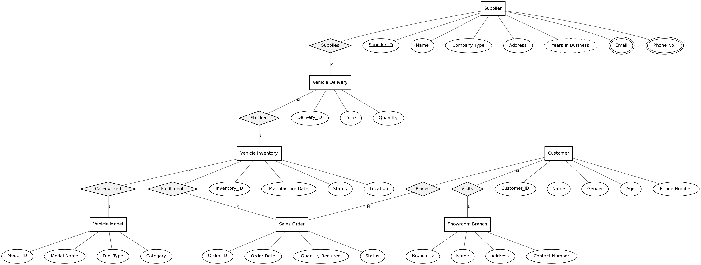

# Car Showroom Management System

A database-driven showroom management project built for an RDBMS lab. It contains the full MySQL database (constraints, DML, joins, subqueries, views, privileges, transactions, triggers and stored procedures), a Flask web app that works on top of it, and a static website with an interactive ER diagram.

**Author:** Samrat Jaiswal

## What is inside

| Folder | Contents |
|---|---|
| `database/` | MySQL scripts: schema, sample data, views, triggers and procedures, privileges, transaction demo |
| `app/` | Flask web application (CRUD pages, views, procedures, live lab queries) |
| `docs/` | GitHub Pages website (`index.html`), ER diagram, lab record (PDF and Markdown), project report, viva script |

## ER diagram



Seven entities: Supplier, Vehicle Delivery, Vehicle Inventory, Vehicle Model, Sales Order, Customer, Showroom Branch. Relationships: Supplies (1:M), Stocked (M:1), Categorized (M:1), Fulfillment (1:M), Places (1:M), Visits (M:1).

## Where each lab topic lives

| Lab | Topic | Where |
|---|---|---|
| 4 | Constraints (NOT NULL, UNIQUE, CHECK, PK, FK, DEFAULT) | `database/01_schema.sql` |
| 5 | DML (INSERT, UPDATE, DELETE, UPSERT) | `database/02_sample_data.sql`, app forms |
| 6 | SELECT, WHERE, operators, aggregates | Lab Queries page, `docs/lab_record.md` |
| 7 | Joins | Lab Queries page |
| 9 | Subqueries | Lab Queries page |
| 10 | Views | `database/03_views.sql`, Views page |
| 11 | Privileges | `database/05_privileges.sql` |
| 12 | Transactions, triggers, stored procedures | `database/04_routines_triggers.sql`, `database/transactions_demo.sql`, Procedures and Triggers page |

## Requirements

- MySQL 8.0.16 or later (CHECK constraints are enforced from this version)
- Python 3.10 or later

## Setup

1. **Create the database** (schema, sample data, views, triggers and procedures):

   ```bash
   mysql -u root -p < database/car_showroom_full.sql
   ```

   The same script can be imported through phpMyAdmin or MySQL Workbench.

2. **Create the app user** (privileges):

   ```bash
   mysql -u root -p < database/05_privileges.sql
   ```

3. **Install and run the web app:**

   ```bash
   python -m venv venv
   source venv/bin/activate        # Windows: venv\Scripts\activate
   pip install -r requirements.txt
   python app/app.py
   ```

   Open http://127.0.0.1:5000. If you changed the database user or password, set `DB_USER`, `DB_PASSWORD`, `DB_HOST` and `DB_NAME` (see `.env.example`).

## Web app pages

- **Dashboard:** counts and stock per model (from the `Model_Stock` view)
- **Suppliers, Models, Inventory, Deliveries, Branches, Customers, Sales Orders:** add and delete records. Dropdowns come from the related tables, and deleting a record that other records use is blocked by the foreign keys. Supplier accepts several emails and phones (multivalued attributes)
- **Sales Orders:** update an order to Fulfilled and the `after_order_fulfilled` trigger marks the vehicle Sold. Ordering a vehicle that is already Sold is blocked by the `before_order_insert` trigger
- **Views:** the three views, read live
- **Procedures and Triggers:** calls `GetOrdersByStatus` and `GetAvailableVehicles`, and shows `Order_Log`
- **Lab Queries:** every SELECT and CALL from the lab record, run live against your database

## Website (GitHub Pages)

`docs/index.html` is a self-contained page with an interactive ER diagram and an in-browser data manager. To publish it: push the repository, open **Settings > Pages**, choose **Deploy from a branch**, select the `main` branch and the `/docs` folder, then save.

## Upload to GitHub

```bash
git init
git add .
git commit -m "Car Showroom Management System"
git branch -M main
git remote add origin https://github.com/<your-username>/car-showroom-management-system.git
git push -u origin main
```

## Notes

- The sample passwords in the SQL and `.env.example` are for local learning only. Change them for anything real.
- The sample data matches the lab record, so the Lab Queries page shows the same results as the record until you change the data.

## Licence

MIT, see `LICENSE`.
